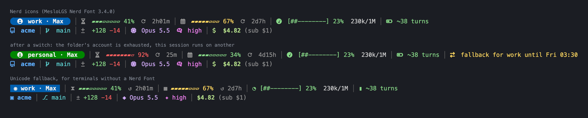

# claudio

Run several Claude Code accounts on one Mac as if they were one: shared conversations, memory,
skills and plugins, per-folder account rules, automatic fallback when an account hits its usage
limit, and one local gateway that starts each MCP server once instead of once per session.

```
claudio work                  # Claude Code logged into the "work" account
claudio auto                  # the account assigned to this folder (fallback if exhausted)
claudio status                # this folder, every account and its usage, sessions, mcpd
claudio limit show --watch    # 5 h and weekly usage of every account, live
```

## Why

Claude Code keeps one login per config directory. Running two accounts means two
`CLAUDE_CONFIG_DIR`s, and by default they share nothing: a conversation started with one account
cannot be resumed with the other, and every session starts its own copy of every MCP server.
With a dozen sessions open, the same browser and API servers run a dozen times over.

claudio fixes both:

- **Profiles.** Each account gets `~/.claude-<name>` with its own credentials and history, and
  symlinks to the shared hub (`~/.claude`) for projects, plans, skills, plugins, agents and
  settings. `claudio <name> --resume <id>` continues any session with any account.
- **Rules.** `config.toml` maps folders to profiles. `claudio auto` picks the right one and, when
  that account is out of quota, a fallback until the reset time.
- **mcpd.** A small HTTP gateway on `127.0.0.1` that every profile's MCP entries point to. It
  answers `initialize` and the tool lists from a cache, starts a server only when a tool is called,
  shares one process between sessions where that is safe, and stops it when idle.
- **Stealth browser.** `claudio-browser-mcp` is the Playwright MCP server built on Patchright, a
  patched Playwright that portals detect far less, with persistent per-identity profiles.
- **Accounts bridge.** A builtin MCP server that lets a session in one profile delegate a task to
  a service account (a Linear workspace, a mail connector) that only another profile is logged
  into, with confirmation for anything that writes.

## Install

Requirements: macOS (Linux works for everything but the Keychain and the LaunchAgent), Node 22.15
or newer, Claude Code (`claude` on PATH).

From the source (pnpm needed):

```sh
git clone <this repository> claudio && cd claudio
pnpm install && pnpm build
ln -s "$PWD/packages/claudio/dist/cli/main.js" ~/.local/bin/claudio
claudio ui install                   # status line font (MesloLGS Nerd Font) and the claudio status line
echo 'source <(claudio completion zsh)' >> ~/.zshrc
claudio doctor
```

Once it is published to npm it installs with `npm install --global <package>` (or pnpm, yarn,
bun, volta), and `claudio upgrade` keeps any of those installs, or a git checkout, up to date.
See [docs/RELEASING.md](docs/RELEASING.md) for versions and releases.

## Quick start

```sh
claudio profile add work --color violet       # declare the profile, create ~/.claude-work and claude-work
claudio profile add personal --browser default
claude-work                                   # log in once per profile (/login)
claudio profile assign ~/code/acme work       # this folder and everything under it uses work
claudio config set default personal           # profile for folders without a rule
claudio status                                # who is logged in where, and their usage
```

`~/.config/claudio/config.toml`:

```toml
system = "personal"     # account the plain `claude` command uses
default = "personal"    # profile for folders without a rule
fallback = "work"       # used while the assigned profile is exhausted

[profiles.work]
color = "violet"        # status line pill
[profiles.personal]
browser = "default"     # claude.ai links open in the default browser instead of a Chrome profile

[[projects]]
path = "~/code/acme"
profile = "work"
```

Point terminals and editors at `claudio auto` (or the `claudio-auto` launcher) and every folder
opens with its account.

## Commands

`claudio --help` groups them; `claudio <command> --help` explains each. Every command that only
reads takes `--json`; every command that writes takes `--dry-run`, keeps a copy of each file it
changes, and prints the `claudio undo <stamp>` that puts them back.

| Command | What it does |
|---|---|
| `claudio <profile> [args]`, `claudio run <profile\|auto> [args]` | Claude Code with that account (replaces the process, args pass through) |
| `claudio auto` | the profile assigned to the current folder, with fallback |
| `claudio profile list\|add\|repair\|remove\|which\|assign\|unassign` | the accounts, and which folders use each |
| `claudio limit show [--watch]\|set <p> [--until \| --for]\|clear <p>` | usage windows, and exhausted marks that move projects to the fallback |
| `claudio session list\|handoff <p> [--fork]` | open sessions, and the command to continue or fork this one under another profile |
| `claudio open [profile] <url>` | open a link; claude.ai links use that profile's Chrome profile |
| `claudio mcp list\|sync\|import\|install\|refresh\|doctor\|daemon ...` | the MCP gateway (below) |
| `claudio identity list\|add\|remove\|login\|prefer\|log` | service accounts for the bridge and browser identities |
| `claudio secret set\|has\|rm\|list` | MCP secrets in the macOS Keychain |
| `claudio browser bench` | stealth browser engines against bot detectors |
| `claudio ui status\|install` | the status line, its font and icons in every terminal |
| `claudio status` | one screen: this folder, profiles and usage, sessions, mcpd, the look |
| `claudio doctor [--fix]` | check everything and repair what is safe to repair |
| `claudio config path\|get\|set\|unset\|edit\|check` | config.toml without losing its comments |
| `claudio undo [--list] [<stamp>\|last]` | put back the files a command changed |
| `claudio upgrade [--check]`, `claudio version` | update claudio the way it was installed |
| `claudio completion zsh\|bash\|fish` | shell completion, including profiles and config keys |
| `claudio migrate` | import the config of the original bash version (`claudio undo` rolls it back) |

The names of 0.1 (`setup`, `which`, `sessions`, `usage`, `exhausted`, `available`, `handoff`,
`accounts`, `mcpd`) and the Spanish ones of the bash version still work.

## MCP gateway

```sh
claudio mcp import --move-secrets            # draft mcp.toml from your current servers
claudio mcp import --move-secrets --write    # write it (secrets go to the Keychain)
claudio mcp install                          # pin npm packages once instead of npx per start
claudio mcp daemon start                     # LaunchAgent that keeps the gateway alive
claudio mcp sync                             # point every profile at the gateway
```

`~/.config/claudio/mcp.toml`:

```toml
[server.calendar]
command = "cal-mcp"
package = "@calcom/cal-mcp@1.4.0"
env = { CAL_API_KEY = "keychain:claudio/calendar/api-key" }
scope = "shared"                 # one process for every session

[server.devtools]
command = "chrome-devtools-mcp"
package = "chrome-devtools-mcp@0.9.0"
scope = "session"                # one per Claude session, stopped when the session ends
idle = "15m"

[server.issues]
command = "issues-mcp"
[server.issues.variant.work]     # the work profile reaches a different account
env = { ISSUES_TOKEN = "keychain:claudio/issues/work" }

[server.browser-school]
command = "claudio-browser-mcp"
args = ["--identity", "school"]
exclusive = true                 # one session at a time drives this browser
lease = "10m"

[server.docs]
url = "https://docs.example.com/mcp"   # remote, written straight into each profile
```

Scopes: `shared` (one process), `project` (one per git repository), `session` (one per Claude
session). Each server variant per profile runs separately, so two profiles can reach two
different accounts of the same service. Details in [docs/mcp.md](docs/mcp.md).

The gateway listens on `127.0.0.1` only, requires a bearer token (mode 600 file), and rejects any
request with an `Origin` header, so a web page cannot reach it.

## Stealth browser

```sh
claudio identity add browser:school  # create an identity and print its mcp.toml entry
claudio identity login browser:school  # sign in by hand once; cookies persist
claudio browser bench --url https://portal.example.edu
```

It uses the installed Google Chrome, headed, with a persistent profile per identity and no init
scripts. Read [ADR 0005](docs/decisions/0005-stealth-browser-defaults.md) for what it does and
does not hide. Use it only with your own accounts and within each site's terms.

## Accounts bridge

```sh
claudio identity add linear:work --profile work --tools 'mcp__linear__*'
claudio identity prefer ~/code/acme linear=linear:work
```

Add `[server.accounts]` with `builtin = "accounts"` to `mcp.toml`. Sessions then get
`accounts_list` and `accounts_delegate`. A delegated task runs headless in the owning profile
with only that account's tools allowed; write tasks need your confirmation in the client, and
every call goes to an audit log (`claudio identity log`).

## Companion plugin

`plugins/claudio` adds the hook that marks a profile exhausted when it hits its limit, plus the
`switch-account` and `fork-session` skills. Install it from this repository:

```
/plugin marketplace add /path/to/claudio
/plugin install claudio@claudio
```

## Status line



```sh
claudio ui install                     # font + statusLine in the shared settings.json
claudio ui install --terminal current  # also set the font in this terminal (Warp, VS Code, Cursor, Alacritty)
claudio ui status                      # what each installed terminal will draw
```

Row 1: profile and plan, 5 h and weekly usage of that account (the freshest any session has
seen) with time to reset, context, estimated turns left, and a warning when a fallback is active
or the folder belongs to another profile. Row 2: project and worktree, branch, lines changed,
model and effort, and the real API-equivalent cost of the conversation including subagents.

The icons come from a Nerd Font. claudio ships MesloLGS Nerd Font 3.4.0 (`packages/fonts`), the
same Nerd Fonts release and icon size as Orca's terminal, and `claudio ui install` copies it into
your user font folder; terminals that ship the symbols
(Ghostty, WezTerm, kitty) need nothing. Where no Nerd Font is set the line falls back to Unicode
icons by itself. Details: [docs/ui.md](docs/ui.md).

## Files

| Path | What |
|---|---|
| `~/.config/claudio/config.toml` | profiles and folder rules |
| `~/.config/claudio/mcp.toml` | MCP servers behind the gateway |
| `~/.config/claudio/accounts.toml` | service accounts for the bridge |
| `~/.local/state/claudio/` | usage, exhausted marks, run records, logs, backups, mcpd token |
| `~/.local/share/claudio/` | installed servers, description cache, browser identities |

All three honor `XDG_CONFIG_HOME`, `XDG_STATE_HOME` and `XDG_DATA_HOME`.

## Development

```sh
pnpm install
pnpm build
pnpm test        # unit and integration tests, sandboxed HOME
pnpm check       # typecheck, tests, and the repository text rules
```

Design: [docs/design](docs/design/2026-11-12-claudio-ecosystem-design.md). Decisions:
[docs/decisions](docs/decisions/). Progress: [docs/STATUS.md](docs/STATUS.md).

## License

MIT
