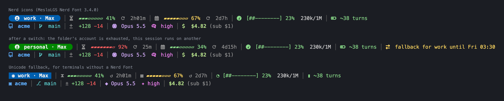

# The turno look of Claude Code

turno changes one part of the Claude Code interface: the status line under the prompt. It
draws account, usage, context, cache, model and cost in two rows, with icons from a Nerd Font.
The reference look is Orca's terminal, which draws them with Nerd Fonts 3.4.0 at full size;
the bundled font gives every other terminal that same look.



## Set it up

```sh
turno ui install                      # font, statusLine, nerd_terminals
turno ui install --terminal current   # the same, and set the font in this terminal
turno ui status                       # check font, status line and every installed terminal
```

`install` does three things. Each is safe to repeat, and every file it changes (fonts included)
is recorded first under `~/.local/state/turno/backups/<stamp>/`; `turno undo <stamp>` puts
everything back:

1. **Font.** It copies MesloLGS Nerd Font 3.4.0 (Regular, Bold, Italic, Bold Italic) into
   your user font folder: `~/Library/Fonts` on macOS, `~/.local/share/fonts` on Linux, where it also runs
   `fc-cache`. No admin password is needed. Every file is checked against its pinned SHA-256
   before it is written. A file with the same name and other contents is left alone unless you
   pass `--force`. Without the `turno-fonts` package the same files are downloaded from the
   [Nerd Fonts v3.4.0 tag](https://github.com/ryanoasis/nerd-fonts/tree/v3.4.0/patched-fonts/Meslo/S)
   and checked against the same checksums.
2. **Status line.** It sets `statusLine` in the hub `~/.claude/settings.json`. Every profile
   links to that file, so one change covers them all. The command is the `turno` on your PATH;
   without one it is the path of the running copy, and `ui install` warns that such a path breaks
   when you switch Node versions. Run from npx's cache, it refuses and asks you to install turno
   first. The line refreshes every 30 s. Keys you added yourself, such as `padding`, are kept.
   `--no-statusline` skips this step.
3. **Icons per terminal.** It records in `config.toml` which terminals already use a Nerd Font
   (`nerd_terminals = ["warp"]`). With `icons = "auto"` (the default) the line uses Nerd icons
   in those terminals and in the ones that ship the symbols, and Unicode icons everywhere
   else. A terminal without the font then shows simple symbols instead of empty boxes.

Restart open terminals after the first install so they pick up the new font.

## Terminals

| Terminal | Nerd icons | What `--terminal` does |
|---|---|---|
| Warp | with a Nerd Font | sets `font_name` in `~/.warp/settings.toml` |
| VS Code, Cursor | with a Nerd Font | sets `terminal.integrated.fontFamily` in the user settings.json, comments kept |
| Alacritty | with a Nerd Font | sets `[font.normal] family` in `alacritty.toml` |
| iTerm2 | with a Nerd Font | nothing: Settings > Profiles > Text > Font, then add `"iterm2"` to `nerd_terminals` |
| Terminal (macOS) | with a Nerd Font | nothing: Settings > Profiles > Text > Font, then add `"apple-terminal"` |
| Ghostty, WezTerm, kitty, Orca | always (they ship the symbols) | nothing needed |

`--terminal` takes `current`, `all` (every installed terminal turno can edit) or a comma list
of ids: `warp`, `vscode`, `cursor`, `alacritty`. turno recognizes the terminal from
`TERM_PROGRAM` and similar variables. VS Code and Cursor both report `vscode`, and turno tells
them apart by Cursor's own variables.

A terminal that already uses another Nerd Font keeps Nerd icons; `turno ui status` suggests
`--terminal <id>` when its font is not the bundled one, because older Nerd Fonts (2.x, such as
the MesloLGS NF that powerlevel10k installs) draw several icons differently: the context
gauge, lines changed and model chip among them. Avoid the `Mono` variants too: they shrink
every icon to one cell. The status line leaves a space after each icon for the full size.

To force one style everywhere, set `icons = "nerd"` or `icons = "unicode"` in `config.toml`.

## What the line shows

Row 1:

| Part | Meaning |
|---|---|
| pill | profile and plan; its color comes from `[profiles.<name>] color` (a name such as `blue`, `green`, `violet`, or a 256-color number) |
| hourglass bar | the account's 5 h usage and time to reset (the freshest value any session of that account has seen) |
| calendar bar | the weekly usage and time to reset |
| gauge | context used, as a bar and as tokens |
| fire or snowflake | prompt cache: time left while warm, or tokens to rewrite once cold |
| battery | turns left in the 5 h window, estimated from how much each recent turn used |
| warnings | a fallback is active, this profile is exhausted, or the folder belongs to another profile |

Row 2: project and worktree, git branch, lines added and removed, model and effort, and the
API-equivalent cost of the conversation. The cost uses the pricing of each model, counts 5 m
and 1 h cache writes apart, includes subagents, and is computed in the background so drawing
the line never waits for it. Until the first count is ready the line shows Claude Code's own
figure followed by `…`. Bedrock and Vertex model ids are priced as the same Anthropic model.
When the conversation used a model turno has no price for, the line shows Claude Code's figure
instead, or `$?` when there is none: never a total that leaves part of the conversation out.

When the agents were set up to use the MCP gateway (`turno mcp sync`) and it does not answer, row
2 ends with `mcpd down`. The line itself only reads a small file; a background check refreshes
it at most once a minute.

The branch comes from the repository's `HEAD` file (worktrees and submodules included), so
drawing the line does not run git. Every part is computed on its own: a damaged cache file, a
full disk or a read-only state folder leaves that part empty and the rest of the line intact.

### Colors and `NO_COLOR`

The status line always draws its colors, also when `NO_COLOR` is set. Claude Code runs the
command with a pipe for output, not a terminal, and draws whatever the command prints inside its
own interface, so the usual signals for "no color here" do not apply to it. Colors in the line
are part of its meaning (usage levels, warnings), and `NO_COLOR` keeps applying to the rest of
turno's output. To drop colors from the line, remove `statusLine` from the hub `settings.json`
or point it at your own command.

Background caches live in `~/.local/state/turno/cache`. Files older than a week are removed by
the cost worker (at most once a day).

## Icons

Every Nerd icon the line uses is in the bundled font, and a test checks that against the
files. If you use another Nerd Font, pick a non-`Mono` one from Nerd Fonts 3.x to get the same
shapes and size.

| Icon | Nerd | Unicode |
|---|---|---|
| account | U+F2BD | ◉ |
| 5 h window | U+F252 | ⧗ |
| week | U+F073 | ▦ |
| reset | U+F0450 | ↺ |
| turns left | U+F242 | ▮ |
| fallback | U+F0EC | ⇄ |
| warning, exhausted, back | U+F071, U+F05E, U+F058 | ⚠ ⊘ ✓ |
| project, worktree, branch | U+F401, U+F402, U+E725 | ▣ ⑂ ⎇ |
| model, effort | U+F2DB, U+F09D1 | ◈ ✦ |
| context | U+F0E4 | ◔ |
| cache warm, cold | U+F0238, U+F0717 | ♨ ❄ |
| lines changed, cost | U+F440, U+F155 | ± |
| pill caps | U+E0B6, U+E0B4 | none |

## Font license

MesloLGS Nerd Font is Meslo LG (Copyright 2009, 2010, 2013 André Berg, Apache License 2.0)
patched with the Nerd Fonts icons (SIL OFL 1.1 and MIT). The files and both licenses are in
`packages/fonts`.
